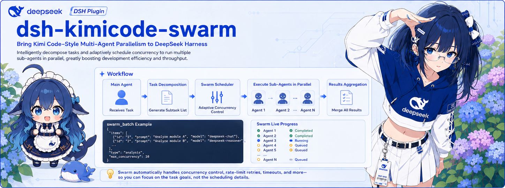
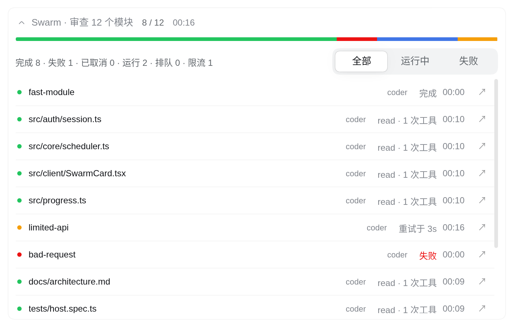

<p align="center">
  <strong>dsh-kimicode-swarm</strong> — batch parallel subagent scheduling for DeepSeek Harness
</p>

<p align="center">
  <a href="./LICENSE"></a>
  <a href="https://github.com/topics/dsh-plugin"></a>
  
  
  <a href="https://awesome-dsh-plugin.com"></a>
</p>

<p align="center">
  <strong>English</strong> · <a href="./README.md">简体中文</a>
</p>

<p align="center">
  
</p>

---

Brings **Kimi Code's Agent Swarm** to DeepSeek Harness. Turn on Swarm mode and the main agent splits the work into independent subtasks, dispatches up to 128 subagents in parallel, and merges the results. You can watch what each subagent is doing, live, right in the chat.

<p align="center">
  
</p>

## Highlights

- **A model per subtask**: any item can name its own model, so the expensive one goes to the hard tasks.
- **Rate limits handle themselves**: automatic backoff that continues the same subagent, at most 8 retries per task. An exhausted quota fails clearly instead of hanging.
- **Cancelling keeps the work**: finished results stay visible to the model on its next turn, and unfinished subagents resume by `agent_id` with their history.
- **You control the bill**: by default nothing dispatches until you turn Swarm mode on, so an agent can't start a hundred subagents by itself.
- **Native UI**: segmented progress, tool activity, rate-limit countdowns, one click into a child session and Markdown results, following DSH's language and light or dark theme.
- **Dispatch with context**: `fork: true` starts subagents with the current conversation history.
- **No runtime dependencies**: everything it needs comes from the host.

## How fast

Scheduling speedup over running one at a time, for independent tasks of a fixed duration:

| Tasks | Host concurrency limit | Serial | Swarm | Speedup |
|---|---|---|---|---|
| 128, 5 minutes each | 128 | 38400 s | 386 s | **99.5x** |
| 128, 60 seconds each | 128 | 7680 s | 146 s | 52.6x |
| 20, 60 seconds each | 128 | 1200 s | 71 s | 17x |
| 128, 60 seconds each | 8 (default) | 7680 s | 965 s | 8x |

This is a scheduling simulation on a virtual clock, and `pnpm bench` reproduces it. It excludes provider rate limits and says nothing about token cost; real speed depends on your tasks and provider. **The default limit caps the speedup at 8x.** Going faster means raising `maxActiveSubagents` (see [Configuration](#configuration)). Parallel work also uses more tokens.

## Quick start

Verified on DeepSeek Harness **0.2.1-rc.5**. DSH's plugin APIs are still moving quickly, so other versions are untested. Versions of this plugin before 0.2.0 do not support DSH 0.2.1.

```bash
dsh plugin --profile web add dsh-kimicode-swarm
```

You can also download `dsh-kimicode-swarm.tgz` from the [GitHub Release](https://github.com/hongyue0721/dsh-kimicode-swarm/releases/latest) and install it:

```bash
dsh plugin --profile web add "file:$PWD/dsh-kimicode-swarm.tgz"
```

Restart `dsh web` and try this in a new session:

```text
/swarm Review each module under src/ and suggest fixes for each
```

## Usage

### Swarm mode

| Command | Effect |
|---|---|
| `/swarm` | Toggle the mode |
| `/swarm on` / `/swarm off` | Keep it on or turn it off; the mode is saved with the session |
| `/swarm <task>` | On for this task only; it ends with the turn |

While the mode is on, a Swarm badge appears in the input area, and clicking it turns the mode off. Subagents cannot dispatch further swarms.

Subagents cannot request extra approval (DSH pins their approval policy to `never`). Operations beyond their delegated permissions are rejected and left to the parent agent, so a batch never stops to wait for approval. The plugin does not change your permission mode.

### Choosing models

From highest priority to lowest: `model` on an item or the batch, then the mapping table on the settings page, then the caller's model.

```json
{ "item": "src/core/scheduler.ts", "model": "deepseek-v4-pro" }
```

### `swarm_batch` parameters

| Parameter | Description |
|---|---|
| `description` | Short description of the whole swarm |
| `prompt_template` | Prompt with a `{{item}}` placeholder; required with `items` |
| `items` | 2 to 128 entries (fewer with `resume_agent_ids`), each a `string` or `{ item, model?, type? }` |
| `model` | Model for the whole batch; overrides the mapping table |
| `subagent_type` | Matches a registered agent preset, then a mapping-table label, and errors if neither matches; omit it to inherit from the parent |
| `fork` | Inherit the conversation up to the last completed turn; cannot combine with `resume_agent_ids`, `model`, `type` or `subagent_type` |
| `resume_agent_ids` | Map of `agent_id` to prompt that continues existing subagents, started before new tasks |

`fork` suits subtasks that need context, but every subagent carries the full history, so it costs more tokens.

## Configuration

Model mapping, timeout and concurrency can be edited in the web UI under Plugins → dsh-kimicode-swarm, and apply to the next dispatch. They are stored with the profile entry (`~/.dsh/profiles/<profile>/cordis.patch.yml`):

```yaml
- id: dsh-kimicode-swarm
  name: dsh-kimicode-swarm
  config:
    requireSwarmMode: true      # false lets the agent call it by itself
    timeoutMs: 7200000          # per-subagent timeout, 2 hours by default, 0 for none
    maxConcurrency: 0           # per-batch cap, 0 adds no cap
    modelMappingEnabled: false
    modelMapping:
      - type: explore
        provider: deepseek-official
        model: deepseek-v3
```

`enabled` and `announceToAgent` (both `true` by default) are read when the plugin mounts. They can only be changed in this entry, which remounts the plugin.

**Want it faster?** The host runs at most 8 subagents at once and queues the rest. To raise that, use DSH's subagent settings page or set `maxActiveSubagents` on the profile's `subagent` entry:

```yaml
- id: subagent
  name: '@deepseek-ai/dsh-subagent'
  config:
    maxActiveSubagents: 32
```

## Known limitations

- **Needs the web layer**: the plugin depends on the `webServer` service, so it does not activate in profiles without one, such as `tui` and `headless`.
- **The progress channel is not an auth boundary**: `/swarm-events` rejects cross-site requests, but a same-origin client receives progress for every session and the UI filters it. It listens on localhost by default; take care before exposing it with `--host`.
- **No token-level progress**: progress shows status, tool call count and the latest tool name.
- **A cancelled batch shows text after a refresh**: its status rows are gone after reloading the page, while the result text remains.
- **No file locking**: write conflicts between subagents are avoided by how tasks are split, same as Kimi Code.

See [docs/KNOWN-ISSUES.md](docs/KNOWN-ISSUES.md) for more.

## Development

```sh
pnpm install
pnpm typecheck
pnpm test        # 159 tests
pnpm build       # output in lib/
pnpm bench       # reproduce the scheduling numbers above
```

Design details and the comparison with Kimi Code are in [docs/architecture.md](docs/architecture.md). The scheduling algorithm draws on [Kimi Code](https://github.com/MoonshotAI/kimi-code) (MIT).

Feedback: [Issues](https://github.com/hongyue0721/dsh-kimicode-swarm/issues)
