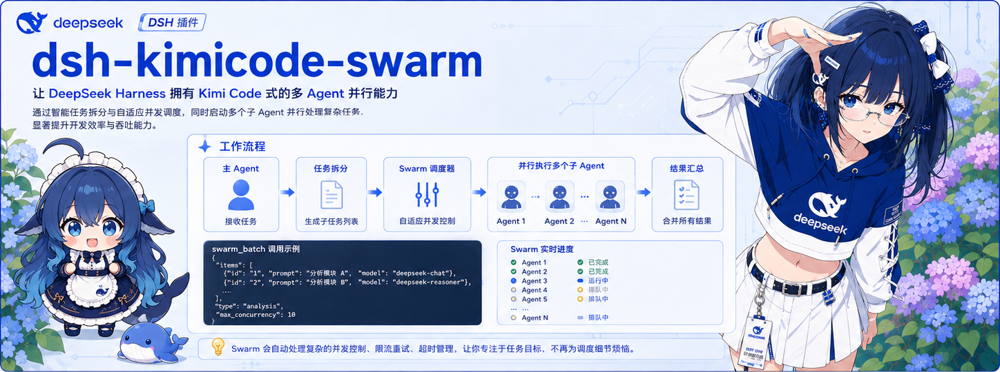
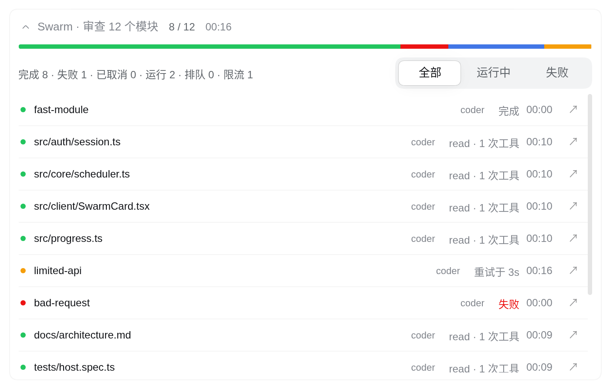

<p align="center">
  <strong>dsh-kimicode-swarm</strong> — DeepSeek Harness 批量并行子 Agent 调度
</p>

<p align="center">
  <a href="./LICENSE"></a>
  <a href="https://github.com/topics/dsh-plugin"></a>
  
  
  <a href="https://awesome-dsh-plugin.com"></a>
</p>

<p align="center">
  <a href="./README.en.md">English</a> · <strong>简体中文</strong>
</p>

<p align="center">
  
</p>

---

受 **Kimi K2.5 Agent Swarm** 与 **Kimi Code** 启发，为 DeepSeek Harness 带来批量并行子 Agent 调度能力。开启 Swarm 模式后，主 Agent 会将大型任务拆解为互不依赖的子任务，单批并发派发最多 128 个子 Agent 协同执行，并在聊天界面实时展示每个子 Agent 的进展与结果。

<p align="center">
  
</p>

## 核心特性

- **按任务定制模型**：支持为单个子任务或整批任务指定专属模型，将高阶模型集中在复杂子任务上。
- **自适应并发与限流恢复**：阶梯式爬坡启动，遇到 429 限流时自动指数退避并收缩并发窗口，冷却后在同一子 Agent 上继续执行（单任务最多重试 8 次）。
- **中断与断点续做**：随时中断运行中的批次，已完成的子任务结果会保留给主 Agent，未完成的子任务可通过 `agent_id` 携带原有上下文继续执行。
- **可控的启用门槛**：默认需由用户通过 `/swarm` 开启模式后才允许派发，避免主 Agent 在后台意外发起大规模并发调用。
- **原生聊天面板**：内置分段进度条、实时工具调用动态、限流倒计时、子会话一键跳转与 Markdown 结果折叠面板，自动适配 DSH 中英文与深浅色主题。
- **上下文派生（Fork）**：支持 `fork: true`，让子 Agent 直接基于当前已完成的对话历史启动。
- **轻量零依赖**：完全基于宿主提供的插件接口与 UI 原语构建，无额外运行时依赖。

## 调度性能

在各子任务时长固定且相互独立的场景下，Swarm 并行调度相比串行执行的理论提速比：

| 任务规模 | 宿主并发上限 | 串行耗时 | Swarm 耗时 | 提速比 |
|---|---|---|---|---|
| 128 个任务，单项 5 分钟 | 128 | 38400 秒 | 386 秒 | **99.5x** |
| 128 个任务，单项 60 秒 | 128 | 7680 秒 | 146 秒 | 52.6x |
| 20 个任务，单项 60 秒 | 128 | 1200 秒 | 71 秒 | 17x |
| 128 个任务，单项 60 秒 | 8（默认） | 7680 秒 | 965 秒 | 8x |

以上数据来自虚拟时钟下的调度基准测试，可通过 `pnpm bench` 复现。实际运行耗时与 token 用量取决于具体任务复杂度及模型服务商的速率限制。DSH 宿主默认同时运行 8 个子 Agent（对应最高 8 倍提速），如需释放更高并发，可在配置中调大 `maxActiveSubagents`（见[配置](#配置)）。

## 快速开始

支持 DeepSeek Harness **0.2.2-rc.1**（兼容 0.2.1-rc.5；若使用 DSH 0.1.x 请安装本插件的 `0.1.2` 版本）。

```bash
dsh plugin --profile web add dsh-kimicode-swarm
```

安装后重启 `dsh web`，在新会话中输入：

```text
/swarm 审查 src/ 下每个模块，分别给出修复建议
```

## 使用指南

### Swarm 模式

| 命令 | 作用 |
|---|---|
| `/swarm` | 切换当前会话的 Swarm 模式开关 |
| `/swarm on` / `/swarm off` | 持续开启或关闭，状态随会话保存 |
| `/swarm <任务>` | 仅对当前回合开启，回合结束后自动退出 |

开启期间，聊天输入区会显示 Swarm 状态徽标，点击即可随时关闭。为避免无限递归，子 Agent 内部不会再次派发 Swarm 批次。

子 Agent 沿用当前会话已委派的权限运行，不会在执行中途弹窗等待交互式审批；超出委派权限的操作将交回主 Agent 统一处理，确保整批任务顺畅执行。

### 指定模型

模型选择优先级从高到低依次为：单项或整批显式传入的 `model` > 插件设置页的类型映射表 > 继承父 Agent 的模型。

```json
{ "item": "src/core/scheduler.ts", "model": "deepseek-v4-pro" }
```

### `swarm_batch` 参数

| 参数 | 说明 |
|---|---|
| `description` | 当前批次的简短任务描述 |
| `prompt_template` | 包含 `{{item}}` 占位符的提示词模板（传入 `items` 时必填） |
| `items` | 2 到 128 个子任务项（配合 `resume_agent_ids` 使用时可少于 2 项），支持 `string` 或 `{ item, model?, type? }` |
| `model` | 整批任务使用的模型，优先级高于配置映射表 |
| `subagent_type` | 优先匹配宿主已注册的 Agent 预设，其次匹配模型映射表中的类型标签；省略时继承父 Agent 配置 |
| `fork` | 继承截至上一回合的对话历史启动子 Agent（与 `resume_agent_ids`、`model`、`type`、`subagent_type` 互斥） |
| `resume_agent_ids` | `agent_id -> prompt` 映射表，在已有子 Agent 会话上继续推进任务，优先于新任务启动 |

开启 `fork` 适合依赖前文背景的拆解任务；由于每个子 Agent 都会携带完整对话历史，建议结合上下文长度按需启用。

## 配置

模型映射、超时时间与单批并发上限均可在 Web 界面的「插件 → dsh-kimicode-swarm」设置页中调整，保存后对下一次派发立即生效。配置持久化在对应 profile 的配置文件中（`~/.dsh/profiles/<profile>/cordis.patch.yml`）：

```yaml
- id: dsh-kimicode-swarm
  name: dsh-kimicode-swarm
  config:
    requireSwarmMode: true      # 设为 false 时主 Agent 可无需手动开启直接调用
    timeoutMs: 7200000          # 单个子 Agent 超时时间，默认 2 小时，0 表示不限
    maxConcurrency: 0           # 插件侧单批并发上限，0 表示不额外限制
    modelMappingEnabled: false
    modelMapping:
      - type: explore
        provider: deepseek-official
        model: deepseek-v3
```

`enabled` 与 `announceToAgent`（默认均为 `true`）在插件挂载时读取，修改这两项后插件会自动重新挂载。

**提升并发上限**：宿主默认最多同时激活 8 个子 Agent，超出部分由调度器自动排队。如需提高并发度，可在 DSH 的「子智能体」设置页修改，或在 profile 的 `subagent` 条目中配置：

```yaml
- id: subagent
  name: '@deepseek-ai/dsh-subagent'
  config:
    maxActiveSubagents: 32
```

## 使用说明与注意事项

- **运行环境**：实时进度卡片与设置面板基于宿主的 `webServer` 服务构建，插件在 `web` profile 下加载启用。
- **网络与访问控制**：`/swarm-events` 进度流具备跨站请求校验（检查 `Origin` 与 `Host`），同源连接下由前端按会话过滤进度事件。DSH 默认仅监听本地回环地址；若使用 `--host` 将服务暴露至局域网或公网，建议配合反向代理或外层访问控制使用。
- **进度展示粒度**：运行卡片实时跟踪子 Agent 的生命周期状态、工具调用计数、当前活动工具名与运行耗时，子任务的完整回答在执行完成后渲染。
- **页面刷新与状态恢复**：运行中和已完成的批次在刷新页面后均可完整恢复卡片视图；中途手动取消的批次在刷新后会收起实时状态行，并在折叠面板中保留已收集的结果文本。
- **工作区并发协作**：子 Agent 共享当前工作区目录。执行涉及文件写入的任务时，建议按目录或模块边界划分任务项，避免多个子 Agent 同时修改同一文件。

更多平台细节与版本更新记录请参见 [docs/KNOWN-ISSUES.md](docs/KNOWN-ISSUES.md)。

## 开发与验证

```sh
pnpm install
pnpm typecheck
pnpm test        # 运行 160 个单元测试
pnpm build       # 构建产物输出至 lib/
pnpm bench       # 运行虚拟时钟调度基准测试
```

架构设计与 Kimi Code 的实现对照请参见 [docs/architecture.md](docs/architecture.md)。调度算法参考了 [Kimi Code](https://github.com/MoonshotAI/kimi-code)（MIT）。

问题反馈与建议欢迎提交至 [Issues](https://github.com/hongyue0721/dsh-kimicode-swarm/issues)。
