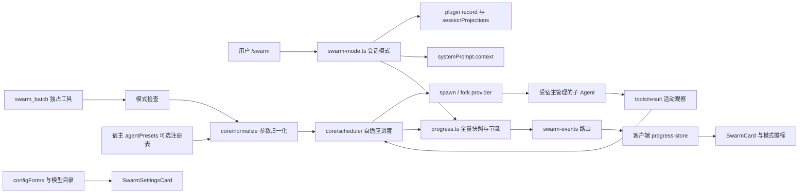

# 架构与设计契约

## 1. 权威与边界

目标宿主为 DeepSeek Harness 0.2.2-rc.1；接口以已安装的宿主实现为准。用户行为和配置见
[README](../README.md)，已知限制及历史修复见 [KNOWN-ISSUES](KNOWN-ISSUES.md)。
本文件负责模块职责、调度契约、进度协议和 Kimi 对照，不维护第二套配置说明。

## 2. 运行架构



### 2.1 模式与提示

`SwarmModeState` 为 `{ active, trigger: 'manual' | 'task' | null, everActive }`。用户命令写入
`appendPluginRecord(session, 'plugin:dsh-kimicode-swarm/mode', state)`，记录携带完整状态并标记
`ignorable: true`。投影折叠记录；`turn/end` 只清除 task 模式，manual 模式保持。
缺失投影或无效记录直接报错，不静默恢复为关闭状态。

普通会话的恢复和 fork 可继承模式；`session.header.origin === 'subagent'` 的委派会话始终读取为未开启。
这是必要的授权隔离：fork provider 会复制父日志，单纯折叠日志会误把父用户的授权授予子 Agent。
子会话命令也拒绝开启模式。`requireSwarmMode: false` 是用户明确选择的旧行为，跳过模式门槛。

静态 `SWARM_GUIDANCE` 宣告默认门槛，动态工作流放在 `systemPrompt.context`，模式切换不重写系统提示 section。
工作流要求先少量探索；不需要拆分时告知用户并停止；否则在一个批次中派发互不重叠的任务，最多 128 项。
rc.5 子 Agent 固定使用审批策略 `never`，无法申请额外审批；越权操作会拒绝，由父 Agent 处理，批次不会等待审批。

`@deepseek-ai/dsh-session-projection` 注册返回异步就绪的 `ProjectionHandle`，插件激活时等待其就绪并通过
`handle.stateOf(session)` 读取状态；`stateSchema` 仅调用 `parse()`，插件复用严格记录校验器，不增加非 SDK 的 Zod 运行时依赖。
宿主源码探针与真实 `SessionProjectionRegistry` 单测已验证第三方 plugin record、投影折叠和 JSON 种子恢复；真实 headless 进程重新加载也验证了磁盘恢复，见第 7 节。

### 2.2 工具与子 Agent

- `defineTool` 输出结构化 `{ subagents: [...] }`；模型 XML 和 `presentationMeta` 都从它投影，不做 XML 反解析。
- `isConcurrencySafe: () => false` 声明独占调度屏障。它不与同响应其他工具重叠，多个 swarm 也顺序执行。
  这是与 Kimi 的有意差异：Kimi 否决含其他工具的响应，DSH 使用原生屏障保留同响应调用的执行顺序。
- 激活使用 `ctx.subagents.startActivation({ provider, label, request, signal, delivery: 'caller' })`。
  发布前取消由 signal 控制，发布后通过 `activation.dispose()` 停止；结果只交给工具，不重复通知父 Agent。
- 续做使用 `sendMessage(parent, childId, content, { signal })`，先监听 `subagent/end` 再投递，避免丢失结束边沿。
  投递接受不等于完成；取消走 `interrupt`。限流后继续同一子 Agent，保留既有工作。
- `fork: true` 使用常量 `FORK_PROVIDER = 'fork'`。宿主只复制上一个 `turn/end` 及之前的平衡历史，当前回合不复制。
  归一化拒绝 fork 与 resume、整批/单项 model、单项 type、subagent_type 的组合；空映射也算传入 resume。
  fork 不走模型映射，不传 `agentOptions` 或 `agentPreset`；provider 缺失直接报错，不降级为 spawn。

### 2.3 预设与模型

异步读取可选的 `ctx.get('agentPresets').list()`，在进入调度前完成解析；纯逻辑 normalize 仅接收解析器。

1. 未显式传类型：不传 `agentPreset`，继承父 Agent 的组合；标签 `coder` 仍参与模型映射。
2. 显式值是预设 ID：传 `agentPreset`；预设已损坏时明确报错。
3. 否则命中映射表类型：仅作为模型标签，不改变工具或角色。
4. 均不匹配：报错并列出预设 ID 和映射类型。没有注册表时第 2 条不可用。

spawn 的模型顺序保持 item 显式值 > 整批显式值 > 启用的类型映射 > 父模型。
宿主将 `agentOptions` 路由和预设组合分别处理，因此显式模型可与预设同时使用。
仅在选择了模型时传 `agentOptions`，provider 缺失时不传该键，避免显式 undefined 覆盖继承值。

## 3. 调度合约

`SpawnFn(task, signal, { retryAgentId, onStarted })` 隔离宿主依赖，测试注入时钟及启动函数。
`onStarted` 表示子 Agent 已发布或续做消息已接受，不把尝试次数当作发布成功数。

**正常阶段**：默认立即启动 5 项，再每 700ms 增加 1 项。插件可另设并发上限；宿主
`maxActiveSubagents`（默认 8）始终有效。`ACTIVATION_LIMIT_REACHED` 作为背压处理：排回队列，
等待运行中任务结束；没有本批运行任务时定时重试，不把宿主容量拒绝当成任务失败。

**限流阶段**：

- 只识别 `agent/request-error` 的结构化 `failure.code === 'RATE_LIMIT'`，不匹配错误文本。
- 容量种子为 `max(1, max(1, startedSuccessCount) - 1)`，其中成功数只在限流阶段以外的 `onStarted` 增加。
  排队任务和未发布尝试不影响容量。后续限流至多每 2 秒收缩 1，下限为 1。
- 单项个人等待从 3 秒按 2 倍增长，保留既有 5 分钟个人延迟上限；限流任务回到队首。
- 全局 `globalRetryIntervalMs` 起始 3 秒。未发布就限流时翻倍，且不小于个人等待；成功发布/接受续做时重置为 3 秒。
- 每次调度最多启动一项；进入限流模式后不再退出。距上次限流及上次恢复均至少 3 分钟时，容量恢复 1。
- 保留 `maxRateLimitRetries = 8`；唯一未完成的任务再次限流时直接失败。Kimi 不设该重试上限，持续耗尽配额时可能互相等待。

**取消与超时**：已完成结果保留；未完成项按是否发布区分 `started/not_started`，有 ID 的任务可以续做。
宿主会替换取消后正常返回的值，因此取消时抛出带 XML 结果的错误，保留模型下一轮可见的工作与 ID。
单任务超时只失败该任务，不停止其他任务。工具 XML 中和封套标签，防止子 Agent 文本伪造结果边界。

## 4. 进度协议与边界

进度是展示数据，不写入会话日志；模式是低频、持久的 plugin record，两者生命周期不同。

```ts
interface SwarmProgressFrame {
  sessionId: string // 父 Agent ID
  callId: string
  subagents: Array<{
    index: number
    item: string | null
    type: string | null
    model: string | null
    status: 'queued' | 'running' | 'rate_limited' | 'completed' | 'failed' | 'aborted'
    retryAt?: number
    retries?: number
    agentId?: string
    startedAt?: number
    settledAt?: number
    toolCalls?: number
    activity?: string
  }>
}
```

- `event: progress` 为保持输入顺序的全量快照，普通更新按调用合并 250ms，终态变化立即发送。
  `item` 只在帧序列化时截到 200 字符，最终结构化结果保留完整值。
- `tools/result` 按 `exec.agent.id` 匹配本批已发布、仍运行的子 Agent，累计已完成工具数及最近工具名。
  时间使用宿主进程时钟；未发布的项不编造启动时间或 ID。终态元数据保留时间和活动统计。
- `event: progress-end` 携带 `{ callId, sessionId }`，只释放对应父会话的快照；`event: mode` 为 `{ sessionId, active, trigger }`。
  新连接补发运行快照和所有已知 active 会话；共享心跳为 15 秒。
- EventSource 瞬断由浏览器自动重连，彻底关闭时指数退避重开。重连清除旧模式缓存，再接收 active 补发，避免遗漏关闭事件后徽标残留。
- 请求带 Origin 且其 host 与 Host 不同时返回 403；无 Origin 的请求可以连接。
  **这不是身份认证**：服务端仍向同源连接广播全部会话，客户端按 sessionId 过滤；不能作为多用户授权隔离。

## 5. 客户端

卡片使用平台 `StateDot`、`DisclosureRow`、`Tag`、`Tooltip`、`TextShimmer` 和 `MarkdownText`。
列表约 320px 高并滚动，超过 8 行提供全部/运行中/失败筛选；memo 行比较全量快照字段，只有忙碌行随秒表刷新。
定时器仅在调用运行时存在；全完成默认折叠，首个失败项默认展开。所有 disclosure 使用 owner 的 hook，跟随宿主回合折叠重置。

取消态保留已收到的状态行，原始结果默认折叠；刷新后没有行快照时仍折叠展示原始结果。
启动前拒绝且无元数据/进度时只显示紧凑提示。子会话跳转使用宿主工作区或侧栏服务；缺少这些可选服务时不显示按钮。
徽标注册在 `conversation.input.left`，通过 `remote.commands.execute(sessionId, '/swarm off', [])` 关闭。

配置页使用原生复选框、输入和按钮；映射草稿不被其他字段保存覆盖，空类型/模型不能保存，目录缺失值仍显示。
`locale.register/bind` 提供中英文，样式只引用宿主 `--dsw-*` 变量并尊重 reduced-motion。
`build/web-platform.ts` 统一平台模块身份；原生 primitives 与 store 在浏览器 bundle 中保持 external。

## 6. Kimi 对照

| 能力 | Kimi Code | 本插件 |
|---|---|---|
| 批量与上限 | AgentSwarm，最多 128 | `swarm_batch`，最多 128 |
| 启动门槛 | 用户开启模式 | 默认用户开启，可显式配置旧行为 |
| 独占 | 否决非唯一工具调用 | DSH 原生独占屏障，保留调用顺序 |
| fork | 实验性参数 | 宿主 fork provider，只复制已完成回合 |
| 类型 | 子 Agent 类型 | spawn 预设 ID 优先，其次映射标签 |
| 模型 | primary/secondary 实验 | 每项/整批显式模型、映射、父模型 |
| 容量与全局退避 | 成功发布数减一，未发布限流翻倍 | 对齐；进入限流后保持该模式 |
| 持续限流 | 无重试上限 | 最多 8 次，保留个人延迟 5 分钟上限 |
| 失败续做 | resume_agent_ids | 同一子 Agent 接收消息并等待结束 |
| 进度界面 | TUI 状态行 | 原生 Web 卡片、模式徽标、SSE 快照 |
| 写冲突 | 语义拆分，无文件锁 | 同，任务需互不重叠 |

## 7. 测试与验收

测试命令为 `pnpm typecheck`、`pnpm test`、`pnpm build`，调度数字用 `pnpm bench` 复现。当前 160 个单元测试覆盖模式、门槛、
fork 冲突、预设四条规则、发布容量种子和全局退避、进度节流/补发、Origin、客户端会话过滤和交互。
客户端单测以平台组件及快照 store 替身验证产品逻辑，不能代替真实宿主验收：它们测不出未声明的宿主服务，
这类错误只在真实上下文访问时才抛出。

真实宿主验收（DSH 0.2.1-rc.5，临时 `DSH_HOME`，本地 HTTP 假模型，无头 Chromium，浅色和深色）确认：
模式关闭时拒绝且没有子 Agent 请求、`/swarm on` 与徽标关闭、运行中的进度和工具活动、页面刷新后进度恢复、
限流倒计时及 429 后接续同一子 Agent、失败行、完成态与 Markdown 结果、子会话跳转、取消中断请求、配置页读写、
跨站 Origin 被拒绝。headless 下确认了 task 回合结束退出、fork 继承已完成历史及拒绝嵌套、模式磁盘恢复。
调大 `maxActiveSubagents` 后 12 个任务全部在第一个任务结束前启动。

真实 DeepSeek 模型（默认 Flash）跑通一次 `/swarm <任务>`：4 个子 Agent 各调用一次 `read` 工具后全部完成，回合结束后模式自动退出；用量 80.7K token，缓存命中 97%。模式关闭时模型收到拒绝后会提示用户开启。

未实机验证：真实服务商的 429 与容量恢复、超时触发、128 项规模、`/swarm-events` 断线重连。这些由单元测试覆盖。
