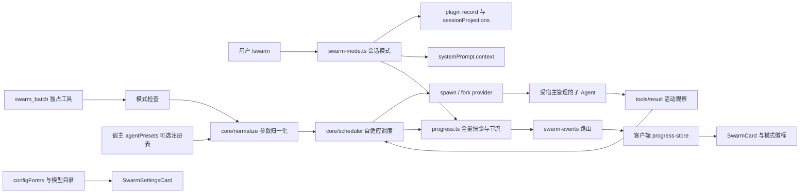

# 架构设计

## 1. 概览

本插件面向 DeepSeek Harness（0.2.2-rc.1），提供批量并行子 Agent 调度与聊天内实时进度面板。安装、使用与配置说明请参考 [README](../README.md)，平台说明与版本变更记录请参考 [KNOWN-ISSUES](KNOWN-ISSUES.md)。本文档介绍插件的核心模块职责、自适应调度机制、进度同步协议，以及与 Kimi Code Agent Swarm 的设计对照。

## 2. 运行时架构



### 2.1 会话模式与提示词注入

会话模式状态定义为 `SwarmModeState`（`{ active, trigger: 'manual' | 'task' | null, everActive }`）。当用户执行 `/swarm` 系列命令时，插件通过 `appendPluginRecord(session, 'plugin:dsh-kimicode-swarm/mode', state)` 写入完整状态记录（标记 `ignorable: true`），并由 `@deepseek-ai/dsh-session-projection` 折叠还原当前状态：

- `manual` 模式（`/swarm on`）跨回合保持开启，直至用户主动关闭；
- `task` 模式（`/swarm <任务>`）在当前回合结束（`turn/end`）时自动退出。

普通会话在恢复或 fork 时会保留模式状态；而由子 Agent 派生的委派会话（`session.header.origin === 'subagent'`）始终读取为未开启，且不响应 `/swarm` 开启命令。这样即使 `fork` provider 复制了父会话日志，子 Agent 也不会继承父会话的派发开关，从根源上避免递归触发 Swarm。若用户在配置中将 `requireSwarmMode` 设为 `false`，则跳过模式门槛检查。

提示词分为两层：静态 `SWARM_GUIDANCE` 声明工具用途与默认开启方式，动态工作流指令通过 `systemPrompt.context` 按需注入，切换模式时无需重写系统提示词主体。工作流引导主 Agent 先做必要的轻量探索，确认适合并行拆解后再通过单次 `swarm_batch` 派发互不重叠的子任务（最多 128 项）。由于宿主将子 Agent 的审批策略固定为 `never`，超出委派权限的操作会直接返回给父 Agent 处理，整批任务不会因等待交互式审批而挂起。

### 2.2 工具执行与子 Agent 生命周期

- **统一结构化输出**：`defineTool` 返回结构化的 `{ subagents: [...] }` 数据，供模型读取的 XML 结果与供前端渲染的 `presentationMeta` 均由该数据直接投影生成。
- **独占调度屏障**：工具声明 `isConcurrencySafe: () => false`，借助 DSH 原生的独占屏障确保 `swarm_batch` 不与同一响应中的其他工具并发重叠，多个批次之间也严格按顺序执行。
- **创建与取消**：新子任务通过 `ctx.subagents.startActivation({ provider, label, request, signal, delivery: 'caller' })` 启动。发布前取消由 `signal` 控制，发布后通过 `activation.dispose()` 终止；结果统一汇总至当前工具调用，避免向父会话重复投递通知。
- **断点续做（Resume）**：续做任务调用 `sendMessage(parent, childId, content, { signal })`，在消息投递前先挂载 `subagent/end` 监听以确保完整捕获结束事件，取消时触发 `interrupt`。遇到 429 限流重试时同样复用原 `agent_id` 继续执行，保留子 Agent 已完成的探索与上下文。
- **上下文派生（Fork）**：传入 `fork: true` 时使用宿主的 `fork` provider，复制截至上一已完成回合（`turn/end`）的对话历史。参数归一化阶段将 `fork` 与 `resume_agent_ids`、`model`、`type`、`subagent_type` 设为互斥，直接沿用父会话的模型与上下文配置。

### 2.3 预设与模型解析

进入调度器前，插件异步读取宿主可选的 `ctx.get('agentPresets').list()` 注册表，并按以下规则解析 `subagent_type` 与目标模型：

1. **未显式指定类型**：不传 `agentPreset`，子 Agent 继承父 Agent 的工具与角色组合；同时默认携带 `coder` 标签参与模型映射表匹配。
2. **匹配宿主预设 ID**：传入对应的 `agentPreset` 以应用预设的角色与工具集。
3. **匹配模型映射表标签**：仅将标签用于路由对应的 `provider` 与 `model`，保持父 Agent 的工具与角色不变。
4. **均不匹配**：返回清晰的错误提示，并列出当前可用的预设 ID 与映射标签。

对于 `spawn` 模式，模型选择的优先级从高到低依次为：单项 `item.model` > 整批 `model` > 启用状态下的类型映射表 > 继承父 Agent 模型。由于宿主将 `agentOptions` 模型路由与 `agentPreset` 独立处理，显式指定模型可与预设组合搭配使用。

## 3. 调度器设计

调度器（`src/core/scheduler.ts`）通过 `SpawnFn(task, signal, { retryAgentId, onStarted })` 与宿主解耦，支持在测试与基准脚本中注入虚拟时钟。`onStarted` 在子 Agent 正式激活或续做消息被宿主接收时回调，用于精确追踪实际运行中的并发度。

### 正常阶段与背压控制

批次启动时默认立即派发前 5 个任务，随后每 700ms 递增派发 1 个任务，平滑拉起并发。运行数受插件 `maxConcurrency` 与宿主 `maxActiveSubagents`（默认 8）共同约束。当触发宿主并发上限（`ACTIVATION_LIMIT_REACHED`）时，调度器将其作为背压信号处理：把当前任务放回队首，等待运行中任务结束释放槽位（若当前批次无运行中任务则定时重试），保证高并发场景下队列平稳推进。

### 限流退避与恢复

当宿主发出 `agent/request-error` 且 `failure.code === 'RATE_LIMIT'` 时，调度器切入限流退避模式：

- **并发窗口收缩**：初始限流容量设为 `max(1, max(1, startedSuccessCount) - 1)`（基于限流前实际成功启动的任务数计算），后续若继续触发限流，每 2 秒至多再缩减 1，最低保持为 1。
- **个体与全局退避**：受限流的单个任务从 3 秒起按指数退避（上限 5 分钟）并排回队首；全局派发间隔 `globalRetryIntervalMs` 同样从 3 秒起步，若任务在启动阶段即遭遇限流则翻倍递增，一旦有任务成功激活则重置回 3 秒。
- **稳态爬坡与重试上限**：限流模式下每次调度仅启动 1 个任务；若距离上一次限流及上一次扩容均已满 3 分钟，则将并发容量加 1。单个任务最多进行 8 次限流重试（`maxRateLimitRetries = 8`）；若批次中仅剩最后一个未完成任务且再次触发限流，则直接结束并返回详情，避免无限期挂起。

### 取消与超时处理

当用户取消批次时，已完成子任务的结果保持不变，未完成任务按实际状态标记为 `started`（附带 `agent_id` 供后续 `resume_agent_ids` 续做）或 `not_started`。为避免宿主在取消时丢弃普通返回值，工具通过抛出包含序列化 XML 的异常将已完成进度和 `agent_id` 传递给下一轮对话。单个子任务超时仅终止该子任务本身，不影响同批次其他任务继续运行。

## 4. 实时进度协议

运行进度作为实时展示状态通过内存与 SSE 流分发，会话模式则作为持久化 plugin record 存储在会话日志中：

```ts
interface SwarmProgressFrame {
  sessionId: string // 父会话 ID
  callId: string
  subagents: Array<{
    index: number
    item: string | null
    type: string | null
    model: string | null
    status: 'queued' | 'running' | 'rate_limited' | 'completed' | 'failed' | 'aborted'
    retryAt?: number
    retries?: number
    agentId?: string
    startedAt?: number
    settledAt?: number
    toolCalls?: number
    activity?: string
  }>
}
```

- **快照节流与终态直达**：`event: progress` 发送保持输入顺序的全量快照；常规状态更新按 `callId` 以 250ms 窗口合并发送，任务进入终态时立即推送。快照中 `item` 描述截断至 200 字符以控制传输体积，最终工具结果保留完整文本。
- **工具活动追踪**：监听 `tools/result` 事件并按 `exec.agent.id` 关联当前批次运行中的子 Agent，实时累加工具调用次数并记录最近一次执行的工具名。
- **生命周期管理**：批次结束时发送 `event: progress-end`（携带 `{ callId, sessionId }`）释放对应快照；模式变更时广播 `event: mode`（`{ sessionId, active, trigger }`）。新建立的 SSE 连接会立即收到当前活跃批次的快照与已开启 Swarm 模式的会话列表，并通过 15 秒共享心跳保活。
- **断线重连**：浏览器端 `EventSource` 瞬时断开时自动重连，连接完全关闭时按指数退避重新建立连接，并在重连后同步最新会话模式状态。
- **同源校验**：`/swarm-events` 路由校验请求头中的 `Origin` host 与 `Host` 是否匹配（拒绝跨站访问），同时支持无 `Origin` 头的本地客户端连接；前端 store 按 `sessionId` 过滤并渲染当前会话的进度卡片。

## 5. 前端界面与设置面板

聊天区卡片（`SwarmCard`）基于宿主 UI 原语（`StateDot`、`DisclosureRow`、`Tag`、`Tooltip`、`TextShimmer`、`MarkdownText`）构建：

- 列表区域最大高度约 320px 并支持内部滚动，子任务超过 8 项时自动显示「全部 / 运行中 / 失败」筛选器；
- 行组件通过 `memo` 对比快照字段，仅运行中或限流倒计时的行随秒表刷新；
- 批次全部完成时默认折叠详情，若存在失败项则自动展开首个失败子任务；
- 支持一键跳转至子 Agent 会话（自动适配宿主工作区或右侧栏导航服务）；
- 输入区左侧挂载 `SwarmBadge`，点击即调用 `/swarm off` 关闭模式；
- 插件设置页（`SwarmSettingsCard`）提供配置开关与模型映射表编辑，所有样式基于宿主 `--dsw-*` CSS 变量并遵循 `prefers-reduced-motion` 无障碍偏好。

## 6. 与 Kimi Code 的设计对照

| 维度 | Kimi Code | dsh-kimicode-swarm |
|---|---|---|
| 批量规模上限 | `AgentSwarm`，单批最多 128 项 | `swarm_batch`，单批最多 128 项 |
| 触发门槛 | 需用户开启 Swarm 模式 | 默认需用户开启，支持配置为自动允许 |
| 工具独占方式 | 拒绝包含其他工具的同回合响应 | 使用 DSH 原生独占屏障，保留同回合调用顺序 |
| 上下文派生（Fork） | 实验性参数 | 接入宿主 `fork` provider，继承已完成回合历史 |
| 子 Agent 类型 | 内置子 Agent 类型 | 优先匹配宿主预设 ID，其次匹配模型映射标签 |
| 模型分配 | 主/次模型切换 | 支持单项指定、整批指定、类型映射表与父模型继承 |
| 限流退避与恢复 | 并发减一、指数退避、3 分钟冷却恢复 | 对齐核心算法，进入限流模式后保持稳态调度 |
| 持续限流保护 | 无限重试 | 单任务最多重试 8 次（单次退避上限 5 分钟） |
| 断点续做 | `resume_agent_ids` | 向同一子 Agent 投递消息并等待新回合完成 |
| 进度交互界面 | 终端 TUI 状态行 | Web 原生进度卡片、输入区模式徽标、SSE 实时流 |
| 工作区并发 | 共享目录，按任务语义拆分规避冲突 | 相同，建议按文件或模块边界拆分写入任务 |

## 7. 测试与验证

项目包含 160 个单元测试与端到端集成验证：

- **单元与组件测试（`pnpm test`）**：覆盖会话模式命令与投影恢复、子会话隔离、`fork` 参数互斥校验、预设与模型四级解析、自适应调度与限流退避曲线、SSE 快照节流与重连补发、`Origin` 跨站拦截，以及前端卡片的筛选、折叠与多会话过滤。
- **调度基准测试（`pnpm bench`）**：基于虚拟时钟模拟不同任务规模与宿主并发上限下的调度耗时。
- **宿主实机验证**：在 DeepSeek Harness Web 与 Headless 环境下验证了模式开关与徽标联动、并发爬坡与 `maxActiveSubagents` 扩容、429 限流倒计时与原会话续做、中途取消与结果保留、子会话跳转、页面刷新状态恢复及真实 DeepSeek 模型下的多子 Agent 协同执行。
